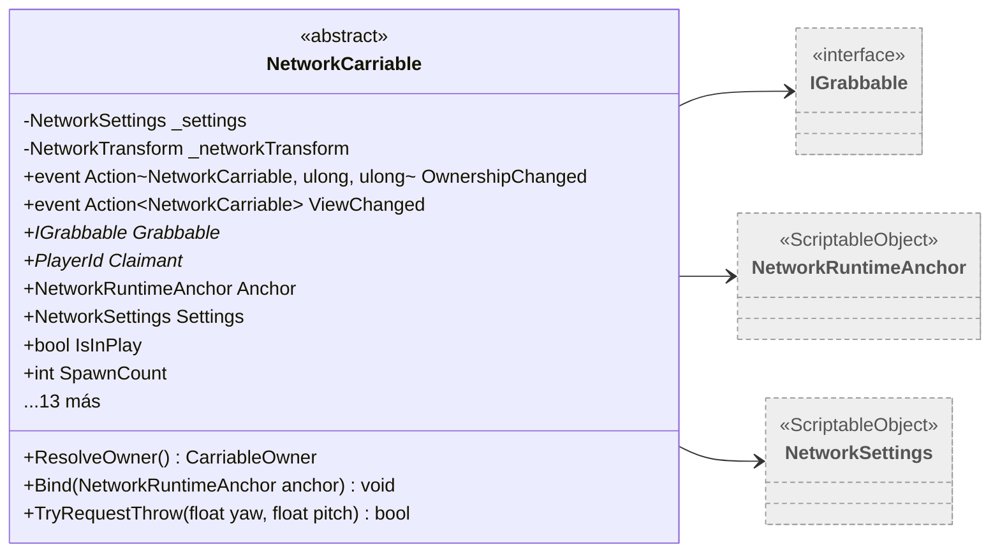

# NetworkCarriable

> Shared network side of something a player carries (animals, bombs). Server: while carried the object is owned by the holder's client and parented under its Player_Net (network parenting); on release it is unparented, teleported to its release pose and (unless the derived class keeps it) given back to the server. The transform stays server-authoritative (NetworkTransform in Server mode), so physics never moves to the owner. Clients: the holder's grabber mirrors the object (SetReplicatedHeld) so aim and throw preview work on the owner. The owner asks the server to throw with `TryRequestThrow`. The pool handlers / spawn registry inject the runtime anchor with `Bind` (no prefab wiring). Presentation (ownership tint, debug label) listens to `ViewChanged`: raised on every instance after spawn, on each ownership change, when the replicated `Claimant` may have changed and on despawn.

**Módulo:** [[Modulo Networking|Networking]] · **Namespace:** `AlienFarms.Networking.Player` · **Archivo:** `Assets/Scripts/Networking/Player/NetworkCarriable.cs`

## Hereda / implementa
`NetworkBehaviour`

## Derivados / implementaciones
[[NetworkAnimal]], [[NetworkBomb]]

## Diagrama

## Usa
[[CarriableOwner]], [[CarriableOwnerRules]], [[IGrabbable]], [[NetworkPlayer]], [[NetworkRuntimeAnchor]], [[NetworkSettings]], [[PlayerGrabber]], [[PlayerId]]

## Usado por
[[CarriableOwnerTint]], [[CarriableOwnershipLabel]], [[Mode]], [[NetworkAnimal]], [[NetworkBomb]], [[NetworkCarry]], [[NetworkPoolLog]], [[NetworkSpawnRegistry]]
