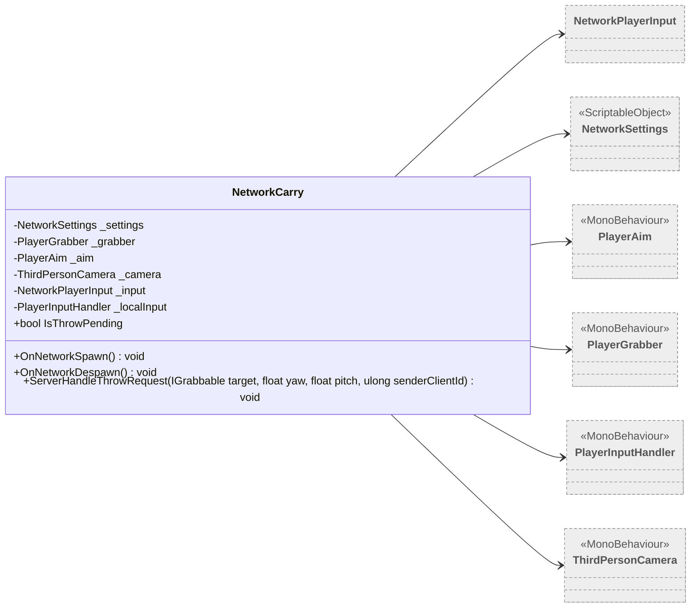

# NetworkCarry

> Release and throw of what a remote player carries. Server, remote avatar: the grabber runs with `ReleaseMode.External`. Grab released without aiming drops (`PlayerGrabber.ReleaseHeld`). Released while aiming waits for the owner's throw request (`NetworkCarriable.TryRequestThrow`); the reported view is validated against the last view the server knows (± `NetworkSettings.ThrowViewTolerance`) before `PlayerGrabber.ThrowWithView`. No request within `NetworkSettings.ThrowRequestTimeout` = plain drop. Owner, pure client: releasing Grab while aiming sends the throw request through the carried object (which this client owns while carrying it) with the camera's current view. Host's own avatar: untouched (local input, `ReleaseMode.Auto`). Runs after the network input applied this step's command and before the grabber.

**Módulo:** [[Modulo Networking|Networking]] · **Namespace:** `AlienFarms.Networking.Player` · **Archivo:** `Assets/Scripts/Networking/Player/NetworkCarry.cs`

## Hereda / implementa
`NetworkBehaviour`

## Diagrama

## Usa
[[DropReason]], [[IGrabbable]], [[IPlayerCommandSource]], [[Mode]], [[NetworkCarriable]], [[NetworkPlayerInput]], [[NetworkSettings]], [[PlayerAim]], [[PlayerGrabber]], [[PlayerInputHandler]], [[ReleaseMode]], [[ThirdPersonCamera]], [[ThrowViewRules]]

## Usado por
[[NetworkPlayer]]
