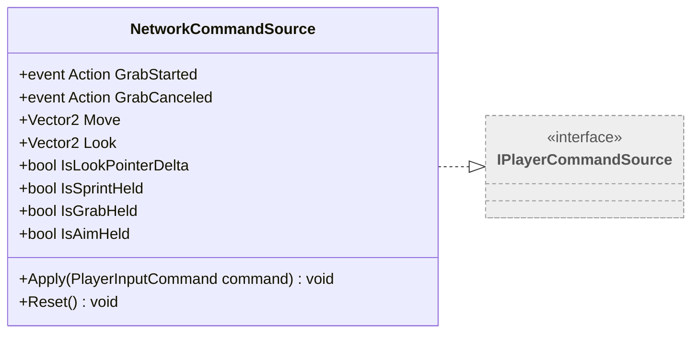

# NetworkCommandSource

> `IPlayerCommandSource` fed with network commands (server side of a remote player). Holds the last applied command and raises `GrabStarted` / `GrabCanceled` on the Grab bit's edges. Look is always zero: the view arrives as an absolute yaw/pitch and is applied to the camera with SetDrivenView.

**Módulo:** [[Modulo Networking|Networking]] · **Namespace:** `AlienFarms.Networking.Player` · **Archivo:** `Assets/Scripts/Networking/Player/NetworkCommandSource.cs`

## Hereda / implementa
[[IPlayerCommandSource]]

## Diagrama

## Usa
[[IPlayerCommandSource]], [[PlayerInputCommand]]

## Usado por
[[Mode]], [[NetworkPlayerInput]]
