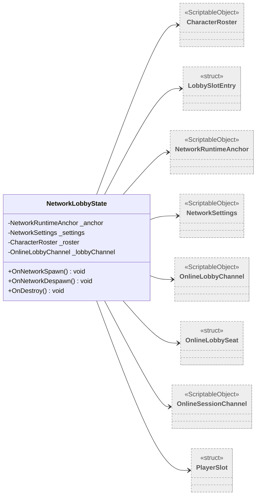

# NetworkLobbyState

> Networked online room (prefab LobbyState, spawned in MainMenu by `LobbyStateSpawner` on the host). The server owns the seats and picks (`LobbyRules` on a 2-entry mirror) and starts the match; every peer republishes the replicated state into the `OnlineLobbyChannel` the menu reads, and forwards the menu's character requests to the server. Everything is event driven: no per-frame work.

**Módulo:** [[Modulo Networking|Networking]] · **Namespace:** `AlienFarms.Networking.Session` · **Archivo:** `Assets/Scripts/Networking/Session/NetworkLobbyState.cs`

## Hereda / implementa
`NetworkBehaviour`

## Diagrama

## Usa
[[CharacterRoster]], [[DisplayNameSanitizer]], [[LobbyRequestResult]], [[LobbyRules]], [[LobbySlotEntry]], [[NetworkRuntimeAnchor]], [[NetworkSceneLoader]], [[NetworkSettings]], [[OnlineLobbyChannel]], [[OnlineLobbyPhase]], [[OnlineLobbySeat]], [[OnlineSessionChannel]], [[OnlineSessionErrorKeys]], [[PlayerId]], [[PlayerSlot]], [[ServerSlotDirectory]]
