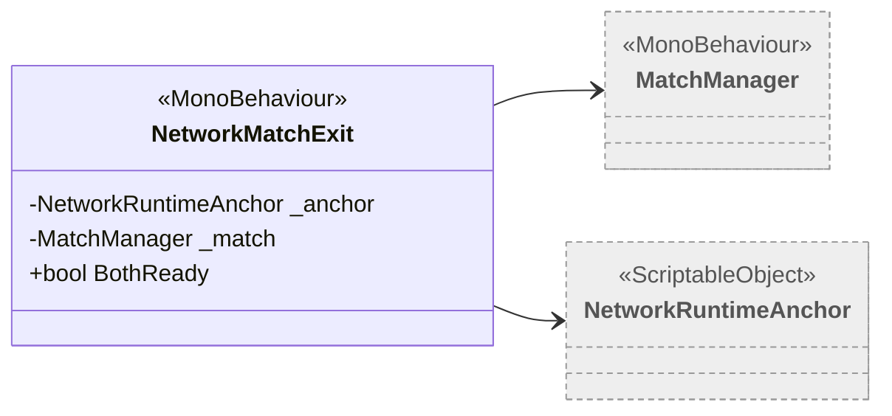

# NetworkMatchExit

> Online rematch (server side). Each player's "Rematch" button sets its own ReadyForRematch (an owner-written NetworkVariable on its NetworkPlayer, see `OnlineMatchExitHandler`). On the server, once both players are ready and the results input delay has passed, the match is restarted (no scene change); owners clear their flag when the phase leaves Results. Returning to the title stays local (exit handler). Lives under OnlineModeRoot; does nothing off the server.

**Módulo:** [[Modulo Networking|Networking]] · **Namespace:** `AlienFarms.Networking.Match` · **Archivo:** `Assets/Scripts/Networking/Match/NetworkMatchExit.cs`

## Hereda / implementa
`MonoBehaviour`

## Diagrama

## Usa
[[MatchManager]], [[MatchPhase]], [[NetworkPlayer]], [[NetworkRuntimeAnchor]], [[PlayerId]]
