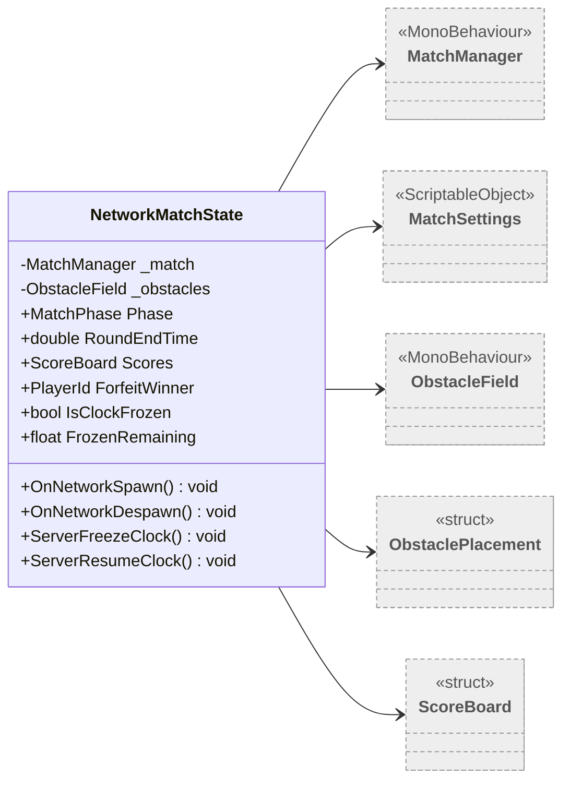

# NetworkMatchState

> Replicated match state, on the in-scene MatchNetwork object (inert in local mode: never spawned). Server: follows the MatchManager through its GameEvents and writes phase, countdown / round end times (server time), the published score board, the forfeit winner (the result's end reason) and the obstacle layout. Pure clients: derive and raise the same GameEvents the server's match raises (phase, countdown ticks and GO, the 1 Hz round time, scores, and the match result from Phase == Results + score board + forfeit winner), and apply the obstacle layout. The timer costs no messages: seconds are derived from RoundEndTime. Suspension (reconnection grace): the server freezes the round clock (`ServerFreezeClock`) and clients show the frozen seconds; `ServerResumeClock` rewrites RoundEndTime in the same tick. Clients process the values in Update, after every variable of the tick has been applied, so a phase change and the scores it depends on are always seen together.

**Módulo:** [[Modulo Networking|Networking]] · **Namespace:** `AlienFarms.Networking.Match` · **Archivo:** `Assets/Scripts/Networking/Match/NetworkMatchState.cs`

## Hereda / implementa
`NetworkBehaviour`

## Diagrama

## Usa
[[GameEvents]], [[MatchClock]], [[MatchManager]], [[MatchPhase]], [[MatchResultRules]], [[MatchSettings]], [[ObstacleField]], [[ObstacleLayoutState]], [[ObstaclePlacement]], [[Phase]], [[PlayerId]], [[ScoreBoard]]

## Usado por
[[ReconnectGraceCoordinator]]

## Eventos que publica
[[Eventos GameEvents#OnCountdownFinished|OnCountdownFinished]], [[Eventos GameEvents#OnCountdownTick|OnCountdownTick]], [[Eventos GameEvents#OnMatchEnded|OnMatchEnded]], [[Eventos GameEvents#OnMatchPhaseChanged|OnMatchPhaseChanged]], [[Eventos GameEvents#OnMatchTimeChanged|OnMatchTimeChanged]], [[Eventos GameEvents#OnScoreChanged|OnScoreChanged]]

## Eventos que escucha
[[Eventos GameEvents#OnMatchPhaseChanged|OnMatchPhaseChanged]], [[Eventos GameEvents#OnMatchTimeChanged|OnMatchTimeChanged]], [[Eventos GameEvents#OnScoreChanged|OnScoreChanged]]
