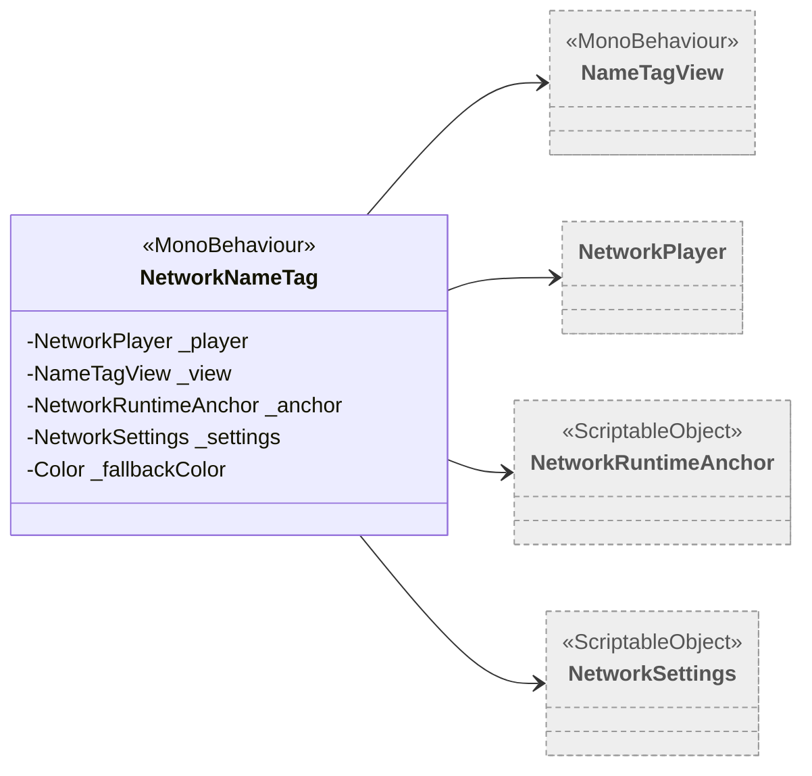

# NetworkNameTag

> Drives the `NameTagView` of a Player_Net avatar (online only; Player.prefab has no tag): Name: the replicated display name, else the seat tag (`CarriableOwnerRules.SeatTag`). Color: the character's Primary theme color. Hidden over this machine's own avatar and while `NetworkSettings.ShowNameTags` is off. Debug line "client N" while `NetworkSettings.NameTagShowsClientId` is on. Faces `NetworkRuntimeAnchor.ViewCamera` (local avatar camera). Update only compares cached values (seat, character, owner client, settings, camera reference) and pushes what changed to the view: no allocation per frame. The name is refreshed on `NetworkPlayer.DisplayNameChanged`.

**Módulo:** [[Modulo Networking|Networking]] · **Namespace:** `AlienFarms.Networking.Player` · **Archivo:** `Assets/Scripts/Networking/Player/NetworkNameTag.cs`

## Hereda / implementa
`MonoBehaviour`

## Diagrama

## Usa
[[NameTagRules]], [[NameTagView]], [[NetworkPlayer]], [[NetworkRuntimeAnchor]], [[NetworkSettings]], [[PlayerId]]
