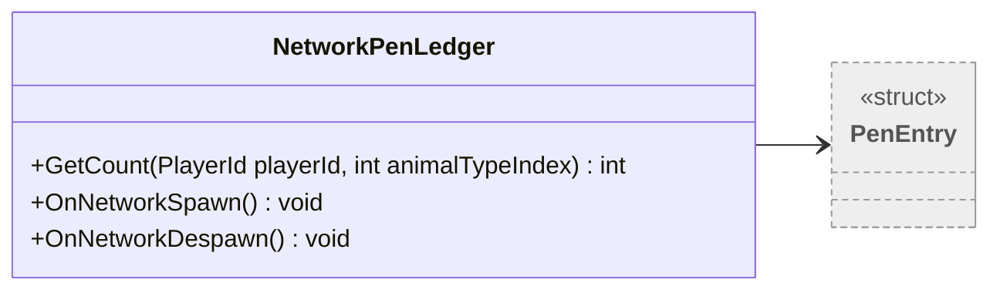

# NetworkPenLedger

> Replicated "inventory" of each pen: one `NetworkList{T}` of `PenEntry` per player, on the in-scene MatchNetwork object (inert in local mode). Server: kept up to date from `GameEvents.OnPenInventoryChanged`. Pure clients: raise that same event from OnListChanged (and once per entry on spawn, so a late joiner sees every pen). The lists are created with the field (NGO requirement), never in OnNetworkSpawn.

**Módulo:** [[Modulo Networking|Networking]] · **Namespace:** `AlienFarms.Networking.Match` · **Archivo:** `Assets/Scripts/Networking/Match/NetworkPenLedger.cs`

## Hereda / implementa
`NetworkBehaviour`

## Diagrama

## Usa
[[GameEvents]], [[PenEntry]], [[PlayerId]]

## Eventos que publica
[[Eventos GameEvents#OnPenInventoryChanged|OnPenInventoryChanged]]

## Eventos que escucha
[[Eventos GameEvents#OnPenInventoryChanged|OnPenInventoryChanged]]
