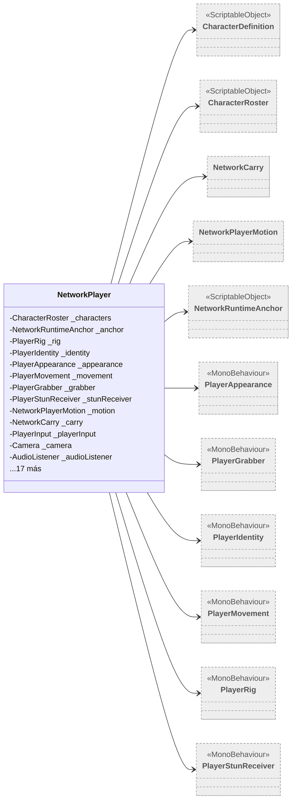

# NetworkPlayer

> Network identity of a Player_Net avatar. The roster hands PlayerId, character and name over before spawning and the server writes them in OnNetworkSpawn (NetworkVariables cannot be written earlier); every instance applies them to `PlayerIdentity` / `PlayerAppearance`. Only the owner enables input, UI input, camera (full screen) and audio listener, and registers itself as the anchor's local player. The orbit camera rig runs on the owner and, on the server, on remote avatars (driven by the client's view). Off the server the simulation runs as Replica (no prediction yet). On pure clients this adapter raises the join/character/leave `GameEvents`; on the server the roster does (no double events on the host).

**Módulo:** [[Modulo Networking|Networking]] · **Namespace:** `AlienFarms.Networking.Player` · **Archivo:** `Assets/Scripts/Networking/Player/NetworkPlayer.cs`

## Hereda / implementa
`NetworkBehaviour`

## Diagrama

## Usa
[[CharacterDefinition]], [[CharacterRoster]], [[DisplayNameSanitizer]], [[GameEvents]], [[MatchPhase]], [[NetworkCarry]], [[NetworkPlayerMotion]], [[NetworkRuntimeAnchor]], [[PlayerAppearance]], [[PlayerGrabber]], [[PlayerId]], [[PlayerIdentity]], [[PlayerMovement]], [[PlayerRig]], [[PlayerSlot]], [[PlayerStunReceiver]], [[SimulationRole]], [[ThirdPersonCamera]]

## Usado por
[[CarriableOwnerTint]], [[LocalPlayerRigLookup]], [[NetworkCarriable]], [[NetworkMatchExit]], [[NetworkNameTag]], [[NetworkPlayerRoster]], [[NetworkRuntimeAnchor]], [[OnlineMatchExitHandler]], [[OnlineMatchStatsRecorder]]

## Eventos que publica
[[Eventos GameEvents#OnPlayerCharacterAssigned|OnPlayerCharacterAssigned]], [[Eventos GameEvents#OnPlayerJoined|OnPlayerJoined]], [[Eventos GameEvents#OnPlayerLeft|OnPlayerLeft]]

## Eventos que escucha
[[Eventos GameEvents#OnMatchPhaseChanged|OnMatchPhaseChanged]]
