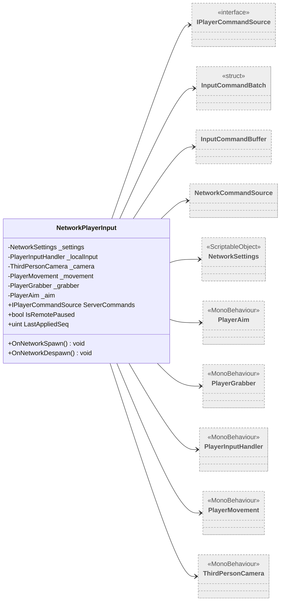

# NetworkPlayerInput

> Input over the network, one command per physics step. Owner (pure client): samples its `PlayerInputHandler` and camera view and sends the last commands unreliably (redundant). Server, remote avatar: buffers them (`InputCommandBuffer`), applies one per step to a `NetworkCommandSource` injected into movement / grab / aim, and drives the camera view so movement is relative to the client's camera. The host's own avatar keeps its local handler. Runs before the gameplay components so they read this step's command.

**Módulo:** [[Modulo Networking|Networking]] · **Namespace:** `AlienFarms.Networking.Player` · **Archivo:** `Assets/Scripts/Networking/Player/NetworkPlayerInput.cs`

## Hereda / implementa
`NetworkBehaviour`

## Diagrama

## Usa
[[IPlayerCommandSource]], [[InputCommandBatch]], [[InputCommandBuffer]], [[Mode]], [[NetworkCommandSource]], [[NetworkSettings]], [[PlayerAim]], [[PlayerGrabber]], [[PlayerInputCommand]], [[PlayerInputHandler]], [[PlayerMovement]], [[ThirdPersonCamera]]

## Usado por
[[Mode]], [[NetworkCarry]], [[NetworkPlayerMotion]]
