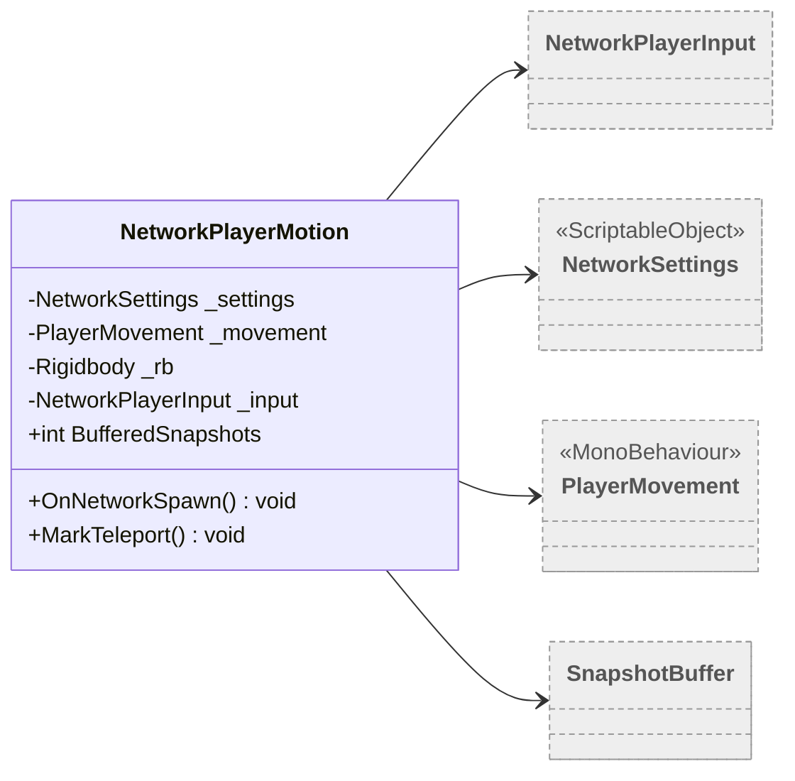

# NetworkPlayerMotion

> Player position sync with custom snapshots (no NetworkTransform: later prediction and lag compensation need to know which server time is drawn). Server: after each physics step sends a `PlayerSnapshot` to every client (unreliable). Clients: buffer them and show the pose at ServerTime - InterpolationDelay on a kinematic body, the owner too (no prediction yet). Teleports snap instead of sliding. Runs before input and movement so the snapshot holds the state the last physics step produced.

**Módulo:** [[Modulo Networking|Networking]] · **Namespace:** `AlienFarms.Networking.Player` · **Archivo:** `Assets/Scripts/Networking/Player/NetworkPlayerMotion.cs`

## Hereda / implementa
`NetworkBehaviour`

## Diagrama

## Usa
[[InterpolatedPose]], [[NetworkPlayerInput]], [[NetworkSettings]], [[PlayerMovement]], [[PlayerSnapshot]], [[PlayerSnapshotFlags]], [[SnapshotAddResult]], [[SnapshotBuffer]], [[SnapshotInterpolator]]

## Usado por
[[NetworkPlayer]]
