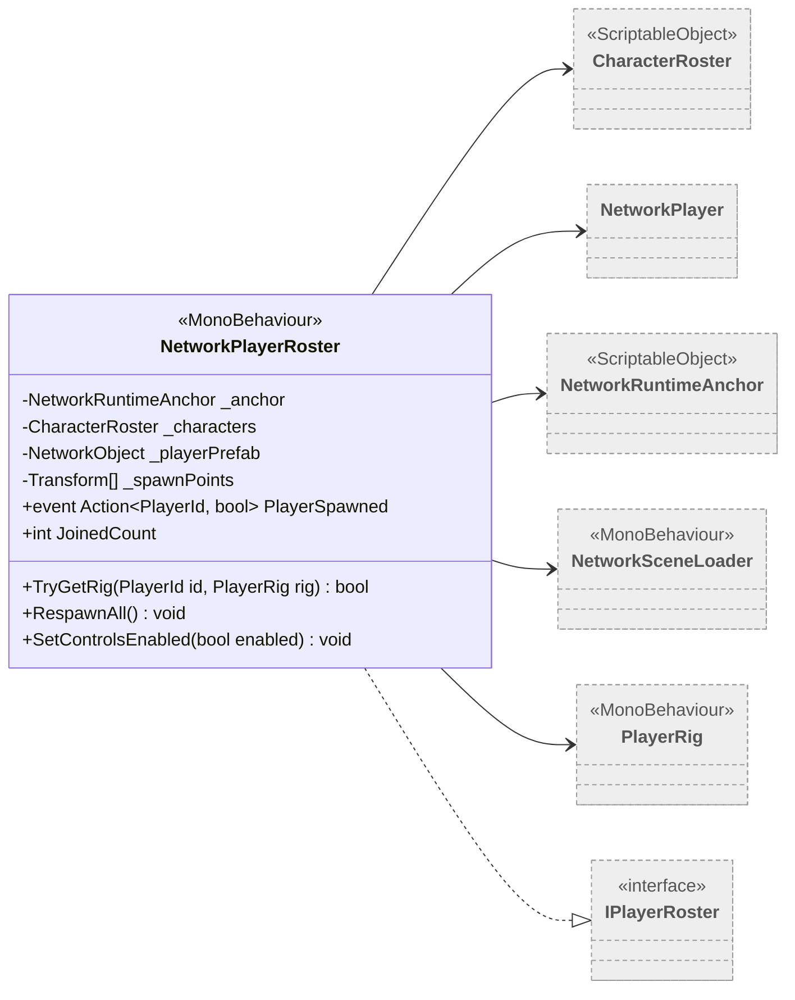

# NetworkPlayerRoster

> Online `IPlayerRoster` (server only): spawns a Player_Net as the player object of every seated client at its seat's spawn point, keeps the registry the match drives (respawn, freeze) and raises `GameEvents.OnPlayerCharacterAssigned` / `GameEvents.OnPlayerJoined` / `GameEvents.OnPlayerLeft` on the server. Inert on clients (they raise those from NetworkPlayer). Lives under the gameplay scene's OnlineModeRoot; the GameModeRouter binds it to the match. Reconnection grace: a dropped player's pose is saved in its seat before its avatar despawns, and the avatar of the returning client is placed there (`PlayerSpawned` with restored = true).

**Módulo:** [[Modulo Networking|Networking]] · **Namespace:** `AlienFarms.Networking.Player` · **Archivo:** `Assets/Scripts/Networking/Player/NetworkPlayerRoster.cs`

## Hereda / implementa
`MonoBehaviour`, [[IPlayerRoster]]

## Diagrama

## Usa
[[CharacterDefinition]], [[CharacterPickRules]], [[CharacterRoster]], [[DropReason]], [[GameEvents]], [[IPlayerRoster]], [[NetworkPlayer]], [[NetworkRuntimeAnchor]], [[NetworkSceneLoader]], [[PlayerGrabber]], [[PlayerId]], [[PlayerRig]], [[PlayerSlot]], [[ServerSlotDirectory]]

## Usado por
[[ReconnectGraceCoordinator]]

## Eventos que publica
[[Eventos GameEvents#OnPlayerCharacterAssigned|OnPlayerCharacterAssigned]], [[Eventos GameEvents#OnPlayerJoined|OnPlayerJoined]], [[Eventos GameEvents#OnPlayerLeft|OnPlayerLeft]]
