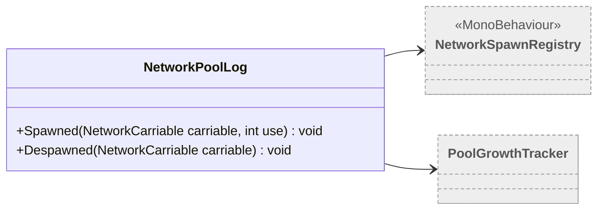

# NetworkPoolLog

> Optional lifecycle log of the network pools (course topics 6 and 7), on server and clients: every network spawn / despawn of a pooled animal or bomb with its use number (first use or reused), the pool counters after it and a mark when the pool had to instantiate past its prewarm size. `NetworkSpawnRegistry` only creates it when NetworkSettings.LogPoolLifecycle is on; otherwise callers hold null and nothing runs.

**Módulo:** [[Modulo Networking|Networking]] · **Namespace:** `AlienFarms.Networking.Pooling` · **Archivo:** `Assets/Scripts/Networking/Pooling/NetworkPoolLog.cs`

## Diagrama

## Usa
[[NetworkAnimal]], [[NetworkCarriable]], [[NetworkPoolStats]], [[NetworkSpawnRegistry]], [[PoolGrowthTracker]]

## Usado por
[[NetworkAnimalPoolHandler]], [[NetworkBombPoolHandler]], [[NetworkSpawnRegistry]]
