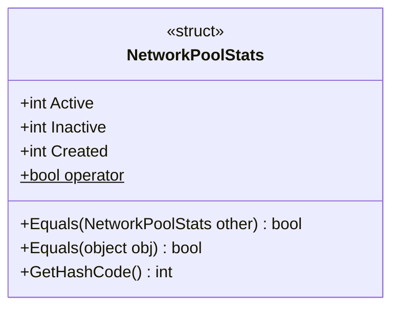

# NetworkPoolStats

> Pool counters for the debug overlay: instances in play, waiting in the pool, and ever created.

**Módulo:** [[Modulo Networking|Networking]] · **Namespace:** `AlienFarms.Networking.Pooling` · **Archivo:** `Assets/Scripts/Networking/Pooling/NetworkPoolStats.cs`

## Hereda / implementa
`IEquatable`

## Diagrama

## Usado por
[[NetworkPoolLog]], [[NetworkSpawnRegistry]], [[NetworkStatsFormatter]], [[NetworkStatsSample]], [[PoolStatsView]]
