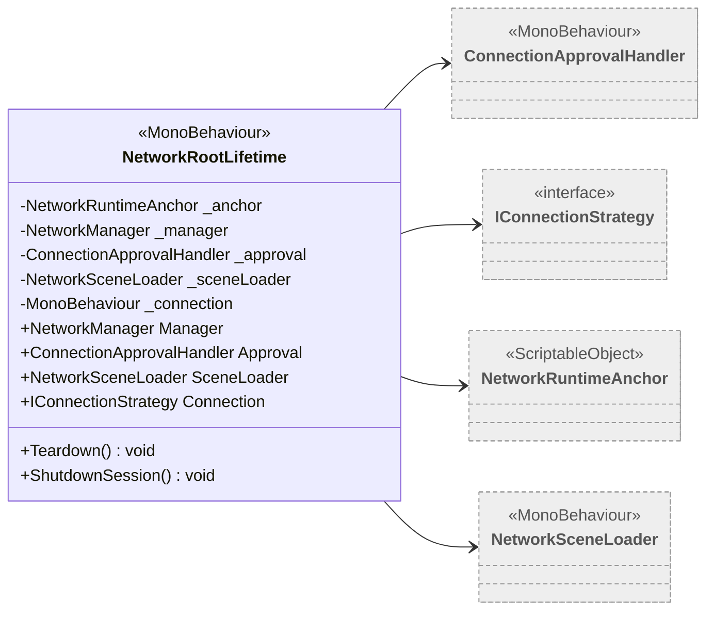

# NetworkRootLifetime

> Lifetime of the persistent NetworkRoot: the first instance survives scene loads and publishes its services on the `NetworkRuntimeAnchor`; any later copy (MainMenu reloaded) deactivates and destroys itself in Awake, before its NetworkManager can claim the singleton. `Teardown` ends the session and removes the root. Runs first so the duplicate guard wins over NetworkManager.OnEnable.

**Módulo:** [[Modulo Networking|Networking]] · **Namespace:** `AlienFarms.Networking.Session` · **Archivo:** `Assets/Scripts/Networking/Session/NetworkRootLifetime.cs`

## Hereda / implementa
`MonoBehaviour`

## Diagrama

## Usa
[[ConnectionApprovalHandler]], [[DisconnectReasons]], [[IConnectionStrategy]], [[NetworkRuntimeAnchor]], [[NetworkSceneLoader]]

## Usado por
[[DevConnectionPanel]], [[NetworkRuntimeAnchor]], [[OnlineMatchBootstrap]], [[OnlineMatchExitHandler]], [[Status]]
