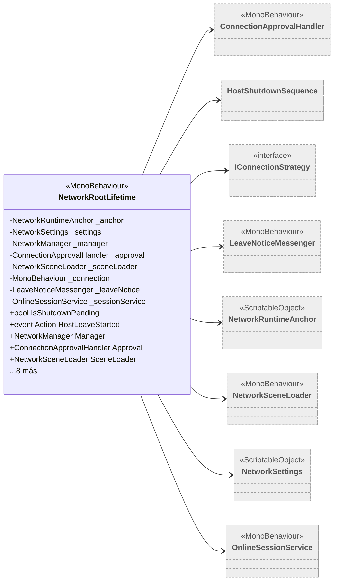

# NetworkRootLifetime

> Lifetime of the persistent NetworkRoot: the first instance survives scene loads and publishes its services on the `NetworkRuntimeAnchor`; any later copy (MainMenu reloaded) deactivates and destroys itself in Awake, before its NetworkManager can claim the singleton. `Teardown` ends the session and removes the root. Runs first so the duplicate guard wins over NetworkManager.OnEnable. A host with remote clients shuts down gracefully (`ShutdownSessionAsync`): it sends the leaving notice, keeps the connections open for `NetworkSettings.HostLeaveNoticeSeconds`, disconnects the clients with `DisconnectReasons.HostDisconnected` and only then stops NGO (see `HostShutdownSequence`). Meanwhile a teardown keeps the root alive (unpublished, in DontDestroyOnLoad) and runs the caller's continuation (loading the next scene) once NGO stopped. Anything else shuts down at once.

**Módulo:** [[Modulo Networking|Networking]] · **Namespace:** `AlienFarms.Networking.Session` · **Archivo:** `Assets/Scripts/Networking/Session/NetworkRootLifetime.cs`

## Hereda / implementa
`MonoBehaviour`

## Diagrama

## Usa
[[ConnectionApprovalHandler]], [[DisconnectReasons]], [[HostShutdownSequence]], [[HostShutdownStep]], [[IConnectionStrategy]], [[LeaveNoticeMessenger]], [[NetworkRuntimeAnchor]], [[NetworkSceneLoader]], [[NetworkSettings]], [[OnlineSessionService]]

## Usado por
[[DevConnectionPanel]], [[NetworkRuntimeAnchor]], [[OnlineMatchBootstrap]], [[OnlineMatchExitHandler]], [[OnlineMatchStatsRecorder]], [[OnlineSessionService]], [[ReconnectGraceCoordinator]], [[SessionExit]], [[Status]]
