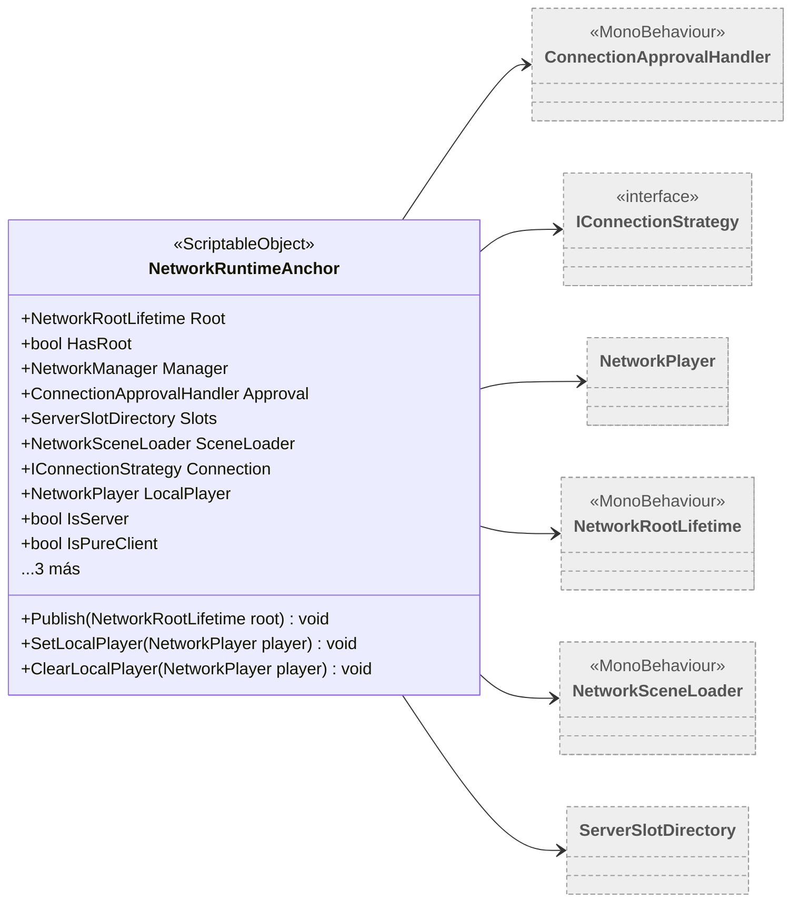

# NetworkRuntimeAnchor

> Runtime anchor: the persistent NetworkRoot publishes its services here so scene objects (roster, bootstrap, dev panel) reach them through a serialized asset reference instead of Find* or singletons. Nothing is serialized; references from a previous play session are discarded through a generation counter (no domain reload).

**Módulo:** [[Modulo Networking|Networking]] · **Namespace:** `AlienFarms.Networking.Data` · **Archivo:** `Assets/Scripts/Networking/Data/NetworkRuntimeAnchor.cs`

## Hereda / implementa
`ScriptableObject`

## Diagrama

## Usa
[[ConnectionApprovalHandler]], [[IConnectionStrategy]], [[NetworkPlayer]], [[NetworkRootLifetime]], [[NetworkSceneLoader]], [[ServerSlotDirectory]]

## Usado por
[[DevConnectionPanel]], [[LocalPlayerRigLookup]], [[NetworkPlayer]], [[NetworkPlayerRoster]], [[NetworkRootLifetime]], [[OnlineMatchBootstrap]], [[OnlineMatchExitHandler]], [[Status]]
