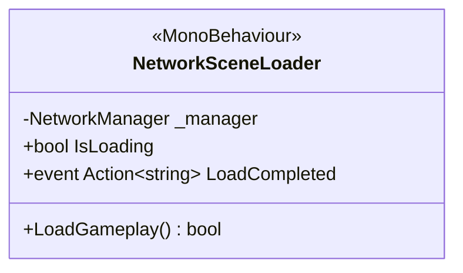

# NetworkSceneLoader

> Server-side scene loading through NGO scene management: the host loads the gameplay scene (Single) and every client, including late joiners, follows on synchronization. Raises `LoadCompleted` once every client finished (or timed out).

**Módulo:** [[Modulo Networking|Networking]] · **Namespace:** `AlienFarms.Networking.Session` · **Archivo:** `Assets/Scripts/Networking/Session/NetworkSceneLoader.cs`

## Hereda / implementa
`MonoBehaviour`

## Diagrama

## Usa
[[SceneNames]]

## Usado por
[[DevConnectionPanel]], [[LobbyStateSpawner]], [[NetworkLobbyState]], [[NetworkPlayerRoster]], [[NetworkRootLifetime]], [[NetworkRuntimeAnchor]], [[Status]]
