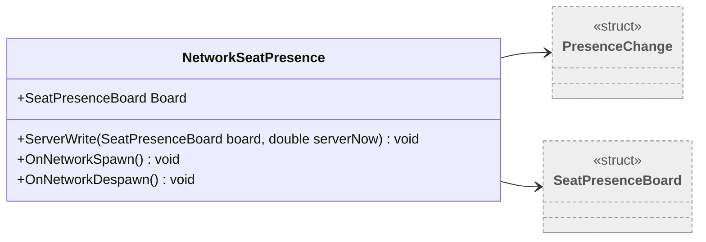

# NetworkSeatPresence

> Replicated `SeatPresenceBoard` on the in-scene MatchNetwork object, written by the server (the `ReconnectGraceCoordinator`). Single emitter of `GameEvents.OnPlayerConnectionChanged`, once per change and per instance: Server: raises when it writes a different board. Pure clients: raise in Update, comparing against the last applied board. On spawn they publish the present state (`SeatPresenceRules.Current`), so a reconnecting client sees a reservation from its first frame.

**Módulo:** [[Modulo Networking|Networking]] · **Namespace:** `AlienFarms.Networking.Match` · **Archivo:** `Assets/Scripts/Networking/Match/NetworkSeatPresence.cs`

## Hereda / implementa
`NetworkBehaviour`

## Diagrama

## Usa
[[GameEvents]], [[PresenceChange]], [[SeatPresence]], [[SeatPresenceBoard]], [[SeatPresenceRules]], [[Status]]

## Usado por
[[ReconnectGraceCoordinator]]

## Eventos que publica
[[Eventos GameEvents#OnPlayerConnectionChanged|OnPlayerConnectionChanged]]
