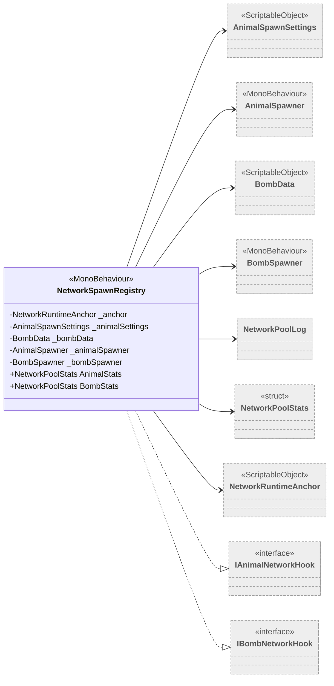

# NetworkSpawnRegistry

> Network pooling of animals and bombs (online gameplay scene, under OnlineModeRoot). Every instance: registers an `INetworkPrefabInstanceHandler` per animal prefab and for the bomb in Awake, before any spawn of this scene can arrive (NGO defers them until the scene finished loading), and removes them on destroy. Server: is the spawners' network hook. A simulation spawn becomes NetworkObject.Spawn (replicated state reset first); a despawn becomes Despawn(false) and the instance goes straight back to its pool. Exposes the pool counters (active, inactive, created) for the debug overlay.

**Módulo:** [[Modulo Networking|Networking]] · **Namespace:** `AlienFarms.Networking.Pooling` · **Archivo:** `Assets/Scripts/Networking/Pooling/NetworkSpawnRegistry.cs`

## Hereda / implementa
`MonoBehaviour`, [[IAnimalNetworkHook]], [[IBombNetworkHook]]

## Diagrama

## Usa
[[Animal]], [[AnimalData]], [[AnimalSpawnEntry]], [[AnimalSpawnSettings]], [[AnimalSpawner]], [[AnimalTypePool]], [[Bomb]], [[BombData]], [[BombSpawner]], [[IAnimalNetworkHook]], [[IBombNetworkHook]], [[NetworkAnimal]], [[NetworkAnimalPoolHandler]], [[NetworkBomb]], [[NetworkBombPoolHandler]], [[NetworkCarriable]], [[NetworkPoolLog]], [[NetworkPoolStats]], [[NetworkRuntimeAnchor]], [[PooledParenting]]

## Usado por
[[NetworkPoolLog]], [[PoolStatsView]]
