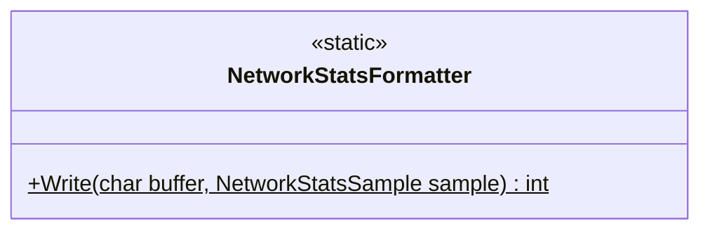

# NetworkStatsFormatter

> Writes a `NetworkStatsSample` into a reusable char buffer (no allocation; shown with TMP_Text.SetCharArray). Pure, so the layout is unit tested. Output truncates if the buffer is too small. Pool activos/en pool/creados Animales 12/78/90 Bombas 1/2/3 Rx 150 pkt/s cola 2.4 max 41/1024 Frame max 612 ms

**Módulo:** [[Modulo Networking|Networking]] · **Namespace:** `AlienFarms.Networking.Diagnostics` · **Archivo:** `Assets/Scripts/Networking/Diagnostics/NetworkStatsFormatter.cs`

## Diagrama

## Usa
[[NetworkPoolStats]], [[NetworkStatsSample]]

## Usado por
[[PoolStatsView]]
