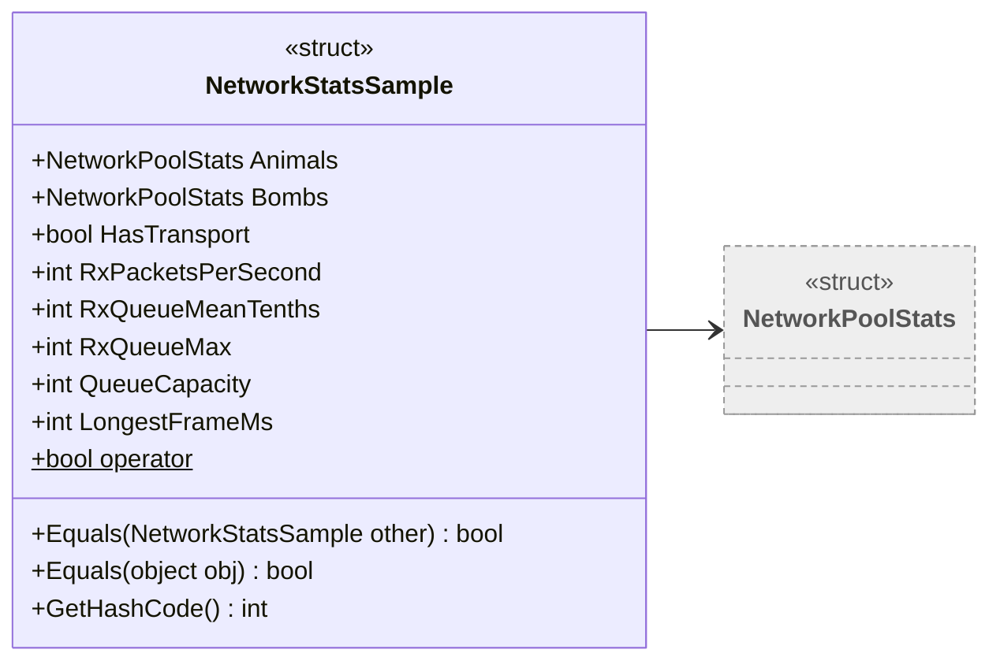

# NetworkStatsSample

> One reading of the online debug stats view: pool counters of this machine and, when a transport is running, its receive side (packets per second, receive-queue usage) and the longest frame since the session started. Compared with the previous reading so the label is rebuilt only when a number changes.

**Módulo:** [[Modulo Networking|Networking]] · **Namespace:** `AlienFarms.Networking.Diagnostics` · **Archivo:** `Assets/Scripts/Networking/Diagnostics/NetworkStatsSample.cs`

## Hereda / implementa
`IEquatable`

## Diagrama

## Usa
[[NetworkPoolStats]]

## Usado por
[[NetworkStatsFormatter]], [[PoolStatsView]]
