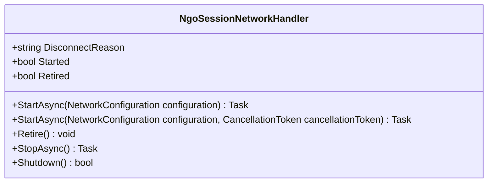

# NgoSessionNetworkHandler

> Sessions network handler for this project's NetworkManager: replaces the SDK's default NGO integration (which uses NetworkManager.Singleton and warns when NGO is shut down outside the session) so the injected root's manager and transport are used, the connection payload/approval written by the caller stay in charge, and the root can shut NGO down itself (host disconnect reasons). One instance per session start; it only ever shuts down an NGO run it started itself, so a stale handler never stops a newer session. Single use: once a start failed, was cancelled, or NGO was stopped, the handler is `Retired` and any later `StartAsync(NetworkConfiguration, CancellationToken)` returns without starting NGO. SDK 2.x (NetworkModule) clears its network property when a client join fails and, on the next ISession.Changed raised while the failed session is torn down, joins the network again with this same handler from an async void: that start must neither run (ghost connection to the host) nor throw (unobserved exception).

**Módulo:** [[Modulo Networking|Networking]] · **Namespace:** `AlienFarms.Networking.Session` · **Archivo:** `Assets/Scripts/Networking/Session/NgoSessionNetworkHandler.cs`

## Hereda / implementa
`INetworkHandler`

## Diagrama

## Usado por
[[RelaySessionConnection]], [[RelaySessionStart]]
