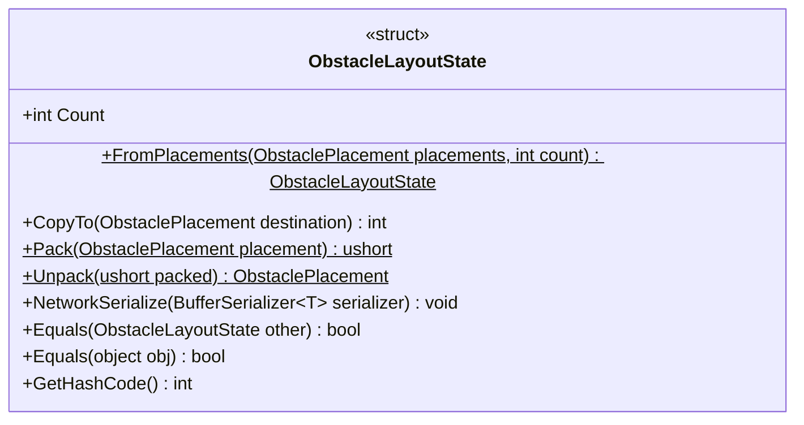

# ObstacleLayoutState

> The obstacle layout of the Animal Zone, one packed slot per `ObstaclePlacement` (slot order): bits 10-15 = variant + 1 (0 = empty slot), bits 0-9 = yaw in 1/1024 turns (~0.35 deg). Fixed size, no allocations.

**Módulo:** [[Modulo Networking|Networking]] · **Namespace:** `AlienFarms.Networking.Match` · **Archivo:** `Assets/Scripts/Networking/Match/ObstacleLayoutState.cs`

## Hereda / implementa
`INetworkSerializable`, `IEquatable`

## Diagrama

## Usa
[[ObstaclePlacement]]

## Usado por
[[NetworkMatchState]]
