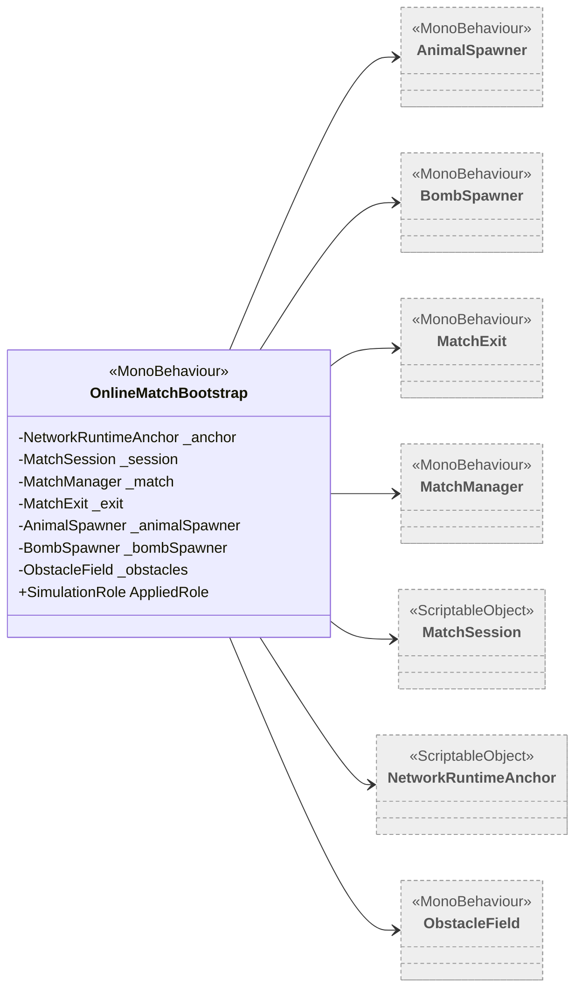

# OnlineMatchBootstrap

> Online setup of the shared match objects. Pure client: the match is the server's, so MatchManager is disabled and the spawners and obstacle field become Replicas (state arrives from the network). On the server everything stays Authority. Every instance: the match exit buttons use the `OnlineMatchExitHandler`. Pure client: when this client is dropped (host left, kicked) the NetworkRoot is torn down and the main menu loaded on the next frame, leaving the reason on the anchor for the menu. Lives under OnlineModeRoot: the GameModeRouter activates it inside its own Awake, so this Awake runs before the obstacle field's Awake and the spawners' Start.

**Módulo:** [[Modulo Networking|Networking]] · **Namespace:** `AlienFarms.Networking.Match` · **Archivo:** `Assets/Scripts/Networking/Match/OnlineMatchBootstrap.cs`

## Hereda / implementa
`MonoBehaviour`

## Diagrama

## Usa
[[AnimalSpawner]], [[BombSpawner]], [[DisconnectReasons]], [[MatchExit]], [[MatchManager]], [[MatchSession]], [[NetworkRootLifetime]], [[NetworkRuntimeAnchor]], [[ObstacleField]], [[OnlineMatchExitHandler]], [[SceneFlow]], [[SimulationRole]]
