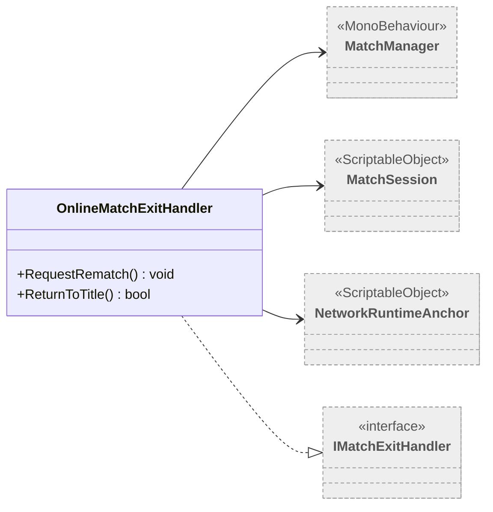

# OnlineMatchExitHandler

> Online match exit (version 1.5). Back to title: clears the session, tears the NetworkRoot down (shutdown + destroy; the MainMenu brings a fresh one) and loads the main menu. Rematch: only the server restarts the match; a client's request is ignored until NetworkMatchExit (1.6) forwards it.

**Módulo:** [[Modulo Networking|Networking]] · **Namespace:** `AlienFarms.Networking.Match` · **Archivo:** `Assets/Scripts/Networking/Match/OnlineMatchExitHandler.cs`

## Hereda / implementa
[[IMatchExitHandler]]

## Diagrama

## Usa
[[IMatchExitHandler]], [[MatchManager]], [[MatchSession]], [[NetworkRootLifetime]], [[NetworkRuntimeAnchor]], [[SceneFlow]]

## Usado por
[[OnlineMatchBootstrap]]
