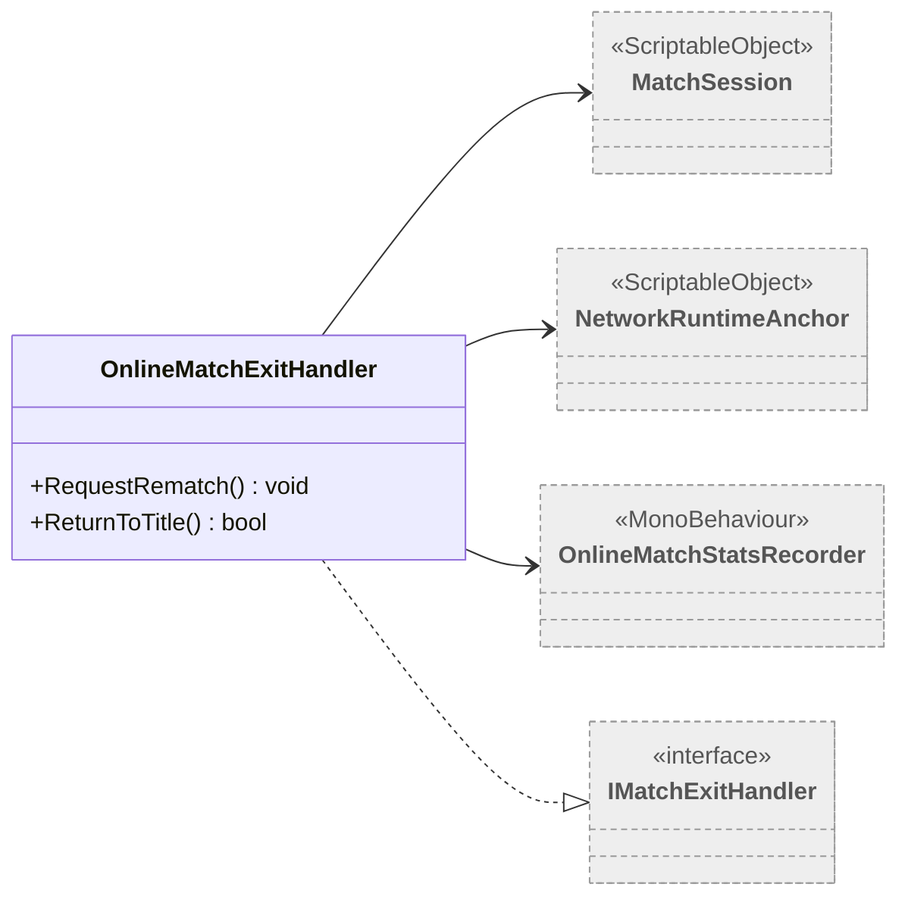

# OnlineMatchExitHandler

> Online match exit. Back to title: records a loss first when leaving during live Playing (persisted before the shutdown, see `OnlineMatchStatsRecorder.RecordLeaveLoss`), clears the session, on a pure client sends the voluntary-leave notice and drops any rejoin offer, tears the NetworkRoot down (shutdown + destroy; the MainMenu brings a fresh one) and loads the main menu once the teardown ended (a host with clients first lets its leaving notice through, see `NetworkRootLifetime.ShutdownSessionAsync`), which opens on the online hub. Rematch: marks the local player ready; the server's `NetworkMatchExit` restarts the match when both players are.

**Módulo:** [[Modulo Networking|Networking]] · **Namespace:** `AlienFarms.Networking.Match` · **Archivo:** `Assets/Scripts/Networking/Match/OnlineMatchExitHandler.cs`

## Hereda / implementa
[[IMatchExitHandler]]

## Diagrama

## Usa
[[IMatchExitHandler]], [[MatchSession]], [[NetworkPlayer]], [[NetworkRootLifetime]], [[NetworkRuntimeAnchor]], [[OnlineMatchStatsRecorder]], [[SceneFlow]]

## Usado por
[[OnlineMatchBootstrap]]
