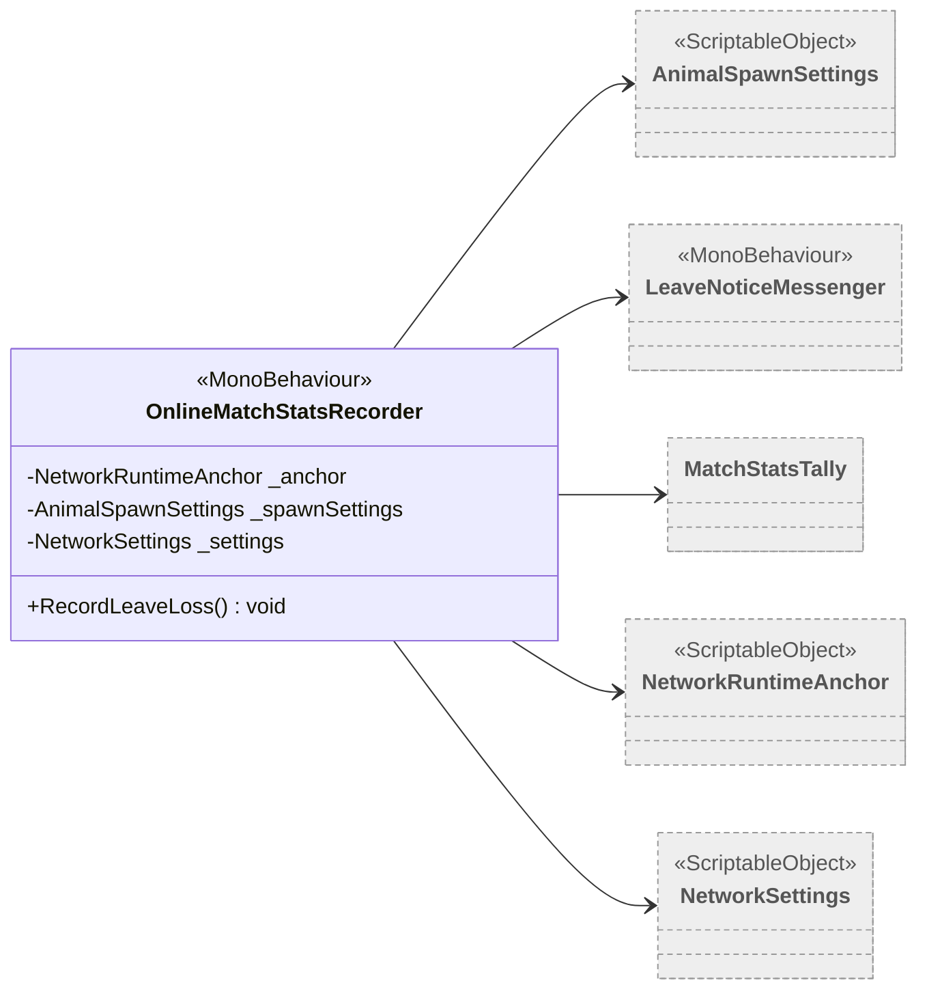

# OnlineMatchStatsRecorder

> Records this machine's online rounds into the stats ledger (task 2.8). Lives under OnlineModeRoot (online only; local matches never count). Only a round whose Playing phase this instance saw live counts, once (`MatchStatsTally`); no stats are recorded without a local seat (`PlayerId.None`). Each round is enqueued with a fresh batch id and the ledger flushes it to PlayerPrefs right away, so it survives closing the game; the cloud save service uploads it. Round end (`GameEvents.OnMatchEnded`, forfeits included): win / draw / loss, animals in the own pen. Leaving on purpose during Playing (`RecordLeaveLoss`, called by the online exit before the shutdown): a loss. The host leaving during Playing (pure client: its leaving notice, `LeaveNoticeMessenger.HostLeavingAnnounced`, or else the NGO drop reason host_disconnected): a win, once, and the ledger raises the host-left win notice the online menu shows (`PlayerStatsLedger.RaiseHostLeftWinNotice`). A drop without that reason (connection lost, host crash) records nothing: this machine cannot know the result.

**Módulo:** [[Modulo Networking|Networking]] · **Namespace:** `AlienFarms.Networking.Persistence` · **Archivo:** `Assets/Scripts/Networking/Persistence/OnlineMatchStatsRecorder.cs`

## Hereda / implementa
`MonoBehaviour`

## Diagrama

## Usa
[[AnimalSpawnSettings]], [[DisconnectReasons]], [[GameEvents]], [[LeaveNoticeMessenger]], [[MatchPhase]], [[MatchResult]], [[MatchStatsTally]], [[NetworkPlayer]], [[NetworkRootLifetime]], [[NetworkRuntimeAnchor]], [[NetworkSettings]], [[PenInventorySnapshot]], [[PlayerId]], [[PlayerStatsLedger]], [[PlayerStatsSummary]]

## Usado por
[[OnlineMatchBootstrap]], [[OnlineMatchExitHandler]]

## Eventos que escucha
[[Eventos GameEvents#OnMatchEnded|OnMatchEnded]], [[Eventos GameEvents#OnMatchPhaseChanged|OnMatchPhaseChanged]]
