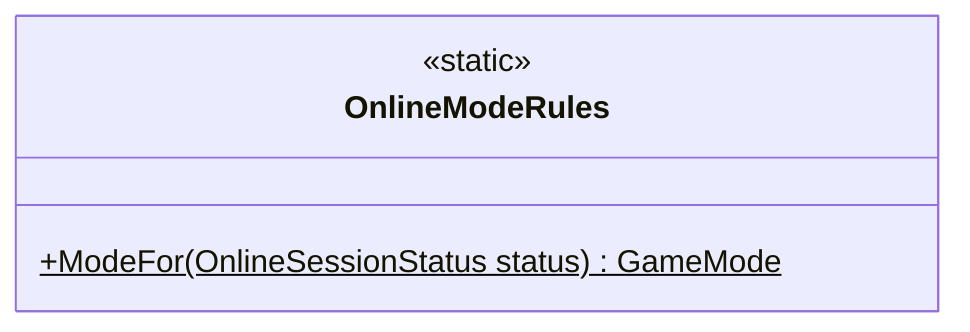

# OnlineModeRules

> Which `GameMode` the `AlienFarms.Data.MatchSession` must hold for an online session status. Online from the moment a create / join / rejoin begins, before NGO starts: the host may approve the client and synchronize the gameplay scene (whose `GameModeRouter` reads the mode in Awake) before the start returns. Local again once the start fails, is cancelled or the session is left. Pure.

**Módulo:** [[Modulo Networking|Networking]] · **Namespace:** `AlienFarms.Networking.Session` · **Archivo:** `Assets/Scripts/Networking/Session/OnlineModeRules.cs`

## Diagrama

## Usa
[[GameMode]], [[OnlineSessionStatus]]

## Usado por
[[OnlineSessionService]], [[SessionExit]]
