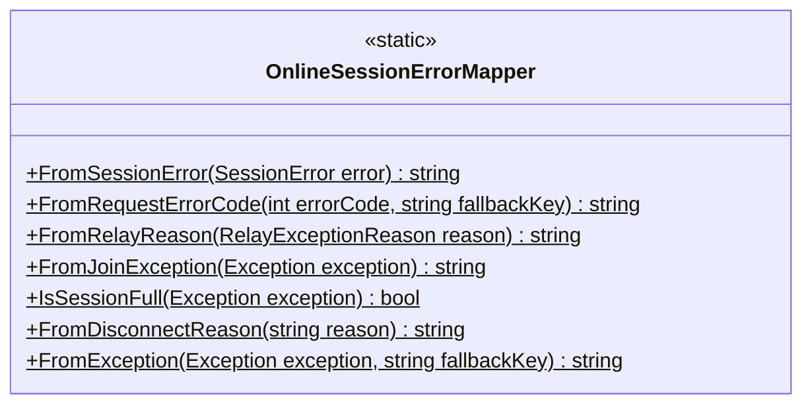

# OnlineSessionErrorMapper

> Maps Unity Gaming Services failures and NGO disconnect reasons to `OnlineSessionErrorKeys`. Pure. Note: the Sessions SDK reports some lobby failures (session full, malformed code) as `SessionError.Unknown` without an inner exception; for a join a full session is recognized by its message (`IsSessionFull`) and anything else surfaces as `OnlineSessionErrorKeys.JoinFailed` (see `FromJoinException`).

**Módulo:** [[Modulo Networking|Networking]] · **Namespace:** `AlienFarms.Networking.Session` · **Archivo:** `Assets/Scripts/Networking/Session/OnlineSessionErrorMapper.cs`

## Diagrama

## Usa
[[DisconnectReasons]], [[OnlineSessionErrorKeys]]

## Usado por
[[OnlineSessionService]], [[RelaySessionConnection]], [[SessionExit]], [[UgsBootstrapper]]
