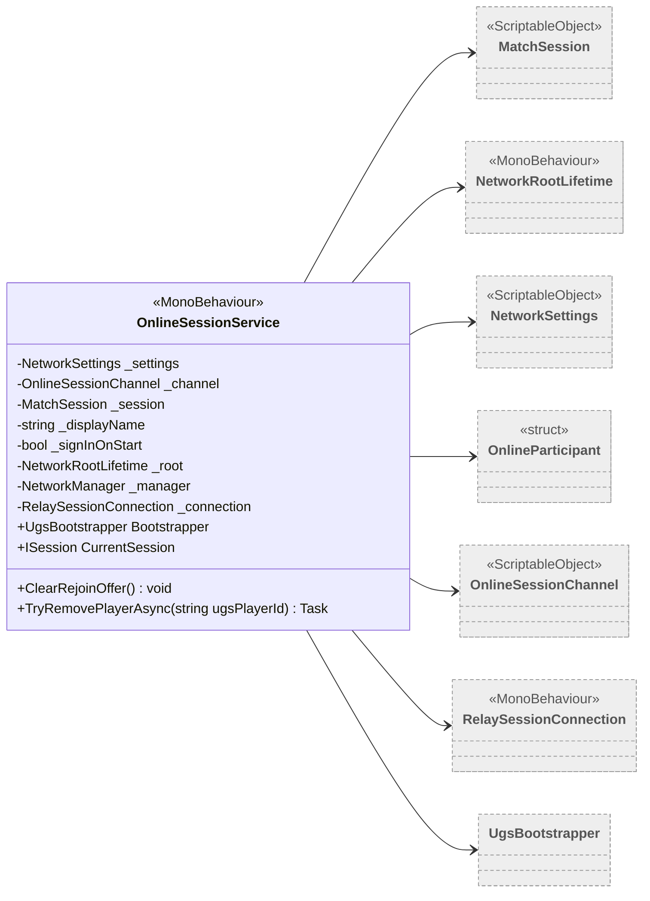

# OnlineSessionService

> Online session service on the persistent NetworkRoot: answers the `OnlineSessionChannel` requests (sign in, create, join by code, leave) through `UgsBootstrapper` and `RelaySessionConnection`, and publishes status, code, participants (two players) and error keys on the channel. NGO is started with the same `ConnectionPayload` and approval as the direct connection. Leaving shuts NGO down through the root first (clients get `DisconnectReasons.HostDisconnected`), then leaves / deletes the session. A Leave (or the root going away) while creating / joining cancels that start; whatever it still created is left as that very instance, and the channel stays Leaving until then.

**Módulo:** [[Modulo Networking|Networking]] · **Namespace:** `AlienFarms.Networking.Session` · **Archivo:** `Assets/Scripts/Networking/Session/OnlineSessionService.cs`

## Hereda / implementa
`MonoBehaviour`

## Diagrama

## Usa
[[ConnectionApprovalHandler]], [[ConnectionPayload]], [[DisplayNameResolver]], [[DisplayNameSanitizer]], [[GameMode]], [[MatchSession]], [[NetworkRootLifetime]], [[NetworkRuntimeAnchor]], [[NetworkSettings]], [[OnlineModeRules]], [[OnlineParticipant]], [[OnlineSessionChannel]], [[OnlineSessionErrorKeys]], [[OnlineSessionErrorMapper]], [[OnlineSessionStatus]], [[PlayerId]], [[RejoinOfferRules]], [[RelaySessionConnection]], [[RelaySessionStart]], [[Status]], [[UgsBootstrapper]]

## Usado por
[[NetworkRootLifetime]], [[ReconnectGraceCoordinator]]
