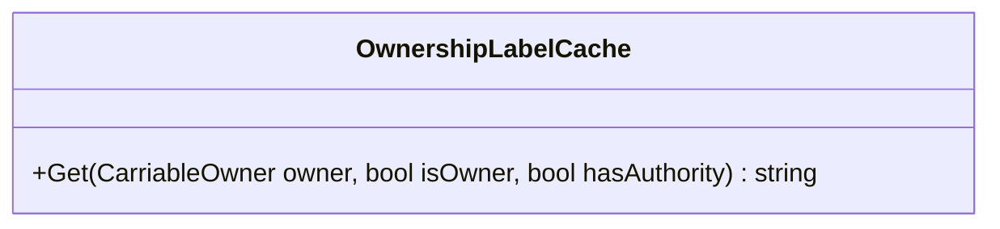

# OwnershipLabelCache

> Every text the ownership debug label can show ("Owner: P2 · IsOwner ✓ · HasAuthority ✗"), built once on first use and then returned by reference: changing the label never allocates.

**Módulo:** [[Modulo Networking|Networking]] · **Namespace:** `AlienFarms.Networking.Player` · **Archivo:** `Assets/Scripts/Networking/Player/OwnershipLabelCache.cs`

## Diagrama

## Usa
[[CarriableOwner]], [[CarriableOwnerRules]]

## Usado por
[[CarriableOwnershipLabel]]
