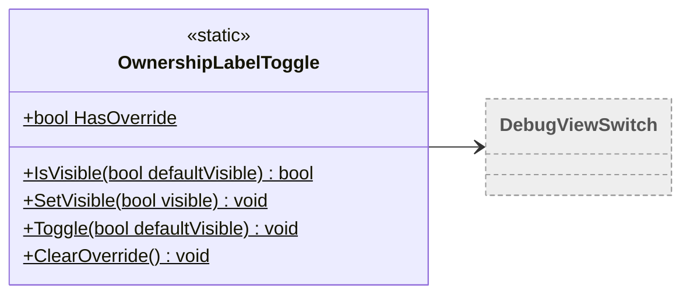

# OwnershipLabelToggle

> Machine-local switch of the ownership debug labels (not replicated, no PlayerId: it is a debug view of this screen). Without an override the labels follow NetworkSettings.ShowOwnershipLabels; the debug overlay (F1–F4, task 3.3) calls `Toggle` / `SetVisible` and every label refreshes through `Changed`. Reset on play-mode entry (no domain reload).

**Módulo:** [[Modulo Networking|Networking]] · **Namespace:** `AlienFarms.Networking.Diagnostics` · **Archivo:** `Assets/Scripts/Networking/Diagnostics/OwnershipLabelToggle.cs`

## Diagrama

## Usa
[[DebugViewSwitch]]

## Usado por
[[CarriableOwnershipLabel]]
