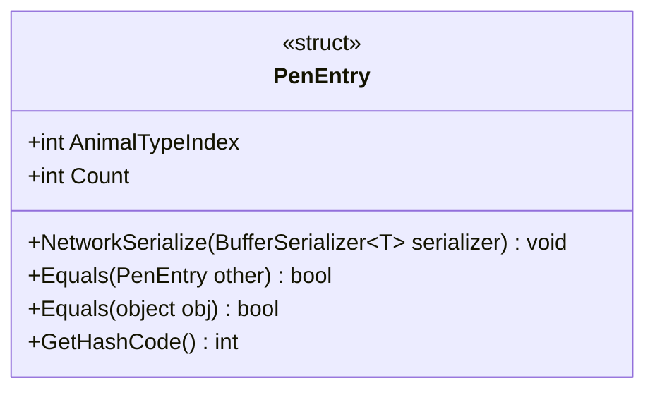

# PenEntry

> One line of a player's pen ledger: how many animals of a type (index in the spawn settings' entries) the pen holds. Element of a NetworkList, so it is unmanaged and equatable.

**Módulo:** [[Modulo Networking|Networking]] · **Namespace:** `AlienFarms.Networking.Match` · **Archivo:** `Assets/Scripts/Networking/Match/PenEntry.cs`

## Hereda / implementa
`INetworkSerializable`, `IEquatable`

## Diagrama

## Usado por
[[NetworkPenLedger]]
