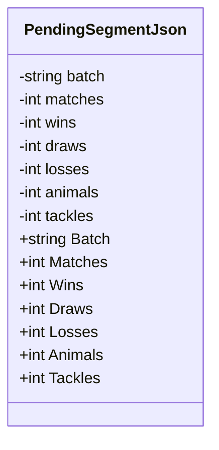

# PendingSegmentJson

> JsonUtility shape of the tail segment of the local pending stats (`PendingStatsCodec`, v2). Field names are the JSON names, so they deliberately break the _camelCase convention.

**Módulo:** [[Modulo Networking|Networking]] · **Namespace:** `AlienFarms.Networking.Persistence` · **Archivo:** `Assets/Scripts/Networking/Persistence/PendingSegmentJson.cs`

## Diagrama

## Usado por
[[PendingStatsCodec]], [[PendingStatsJson]]
