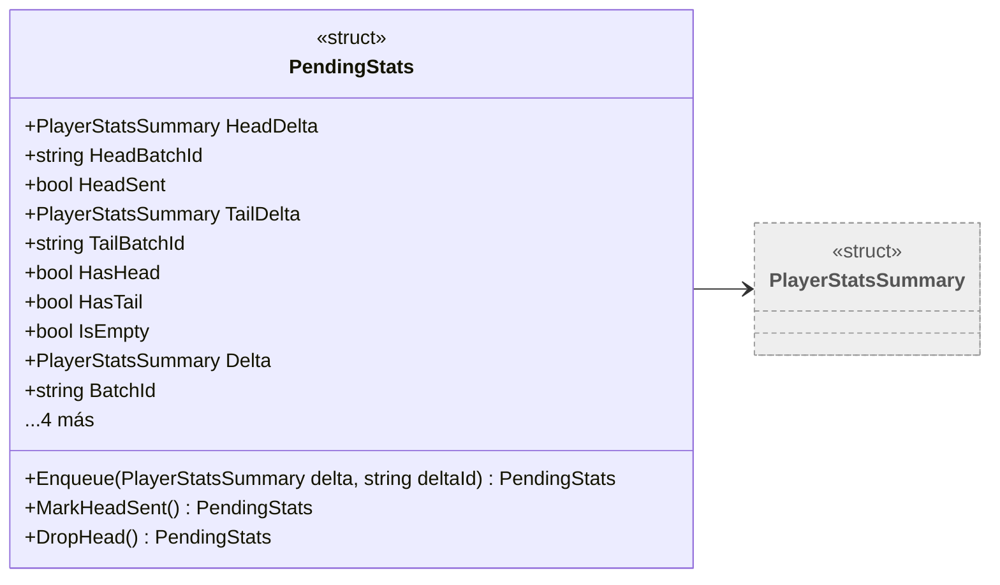

# PendingStats

> Stats recorded on this machine and not yet confirmed by the cloud (persisted locally through `IPendingStatsStore`), in two segments so a delta is never lost behind a batch that may already be applied: Head: what the next (or the in-flight / unanswered) write carries, tagged with `HeadBatchId`. Once sent (`HeadSent`) it is frozen: a write that may have landed with that batch id must be retried with exactly the same content. Tail: rounds enqueued after the head was sent. It becomes the head once the head is confirmed (or found applied), and is merged back into the head when the head is known not to have landed. Invariants (enforced here): no tail without a head, and no tail while the head is unsent (it is merged). Default = nothing pending.

**Módulo:** [[Modulo Networking|Networking]] · **Namespace:** `AlienFarms.Networking.Persistence` · **Archivo:** `Assets/Scripts/Networking/Persistence/PendingStats.cs`

## Hereda / implementa
`IEquatable`

## Diagrama

## Usa
[[PlayerStatsRules]], [[PlayerStatsSummary]]

## Usado por
[[IPendingStatsStore]], [[PendingStatsCodec]], [[PlayerPrefsPendingStatsStore]], [[PlayerStatsLedger]]
