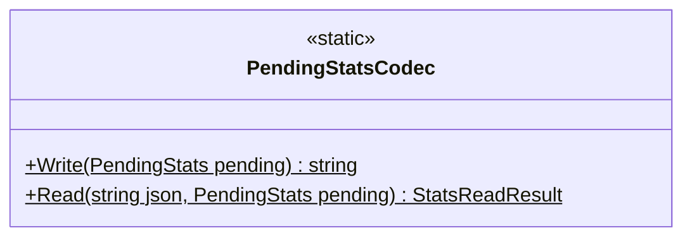

# PendingStatsCodec

> JSON of the local pending stats (v2): { "v":2, "batch":"…", "matches", "wins", "draws", "losses", "animals", "tackles", "sent":bool, "tail":{ "batch", "matches", … } }. The top level is the head (a v1 entry, without "sent" or "tail", reads as an unsent head). Pure (JsonUtility only), so it is tested in EditMode. Called on enqueue and load only, never per frame.

**Módulo:** [[Modulo Networking|Networking]] · **Namespace:** `AlienFarms.Networking.Persistence` · **Archivo:** `Assets/Scripts/Networking/Persistence/PendingStatsCodec.cs`

## Diagrama

## Usa
[[PendingSegmentJson]], [[PendingStats]], [[PendingStatsJson]], [[PlayerStatsRules]], [[PlayerStatsSummary]], [[StatsReadResult]]

## Usado por
[[PlayerPrefsPendingStatsStore]]
