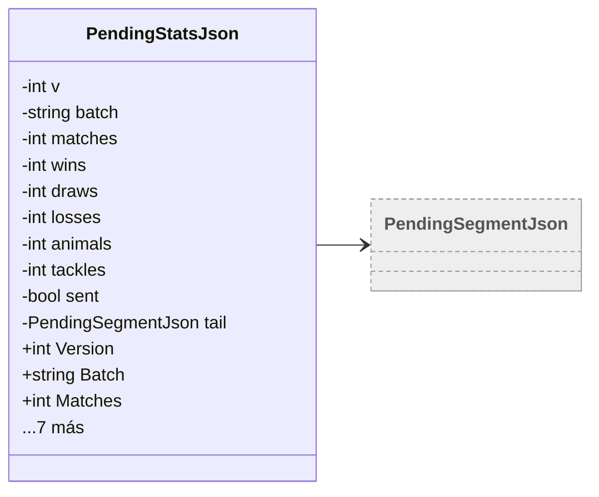

# PendingStatsJson

> JsonUtility shape of the local pending stats (`PendingStatsCodec`): the head at the top level (what a v1 entry holds), plus sent and the tail segment (v2). Field names are the JSON names, so they deliberately break the _camelCase convention.

**Módulo:** [[Modulo Networking|Networking]] · **Namespace:** `AlienFarms.Networking.Persistence` · **Archivo:** `Assets/Scripts/Networking/Persistence/PendingStatsJson.cs`

## Diagrama

## Usa
[[PendingSegmentJson]]

## Usado por
[[PendingStatsCodec]]
