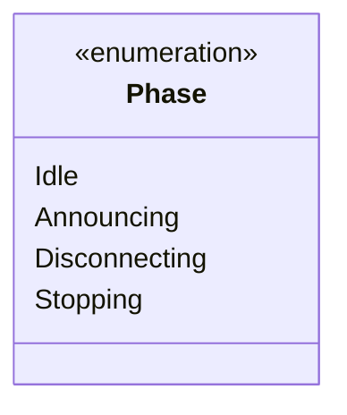

# Phase

**Módulo:** [[Modulo Networking|Networking]] · **Namespace:** `AlienFarms.Networking.Session` · **Archivo:** `Assets/Scripts/Networking/Session/HostShutdownSequence.cs`

## Diagrama

## Valores
`Idle`, `Announcing`, `Disconnecting`, `Stopping`

## Usa
[[HostShutdownStep]]

## Usado por
[[CountdownState]], [[HostShutdownSequence]], [[MatchState]], [[MatchStateMachine]], [[MenuFlowController]], [[NetworkMatchState]], [[OnlineLobbyChannel]], [[OnlineLobbySnapshot]], [[OnlineMenuController]], [[OnlineSessionSfxPlayer]], [[PlayingState]], [[ResultsState]], [[WaitingForPlayersState]]
