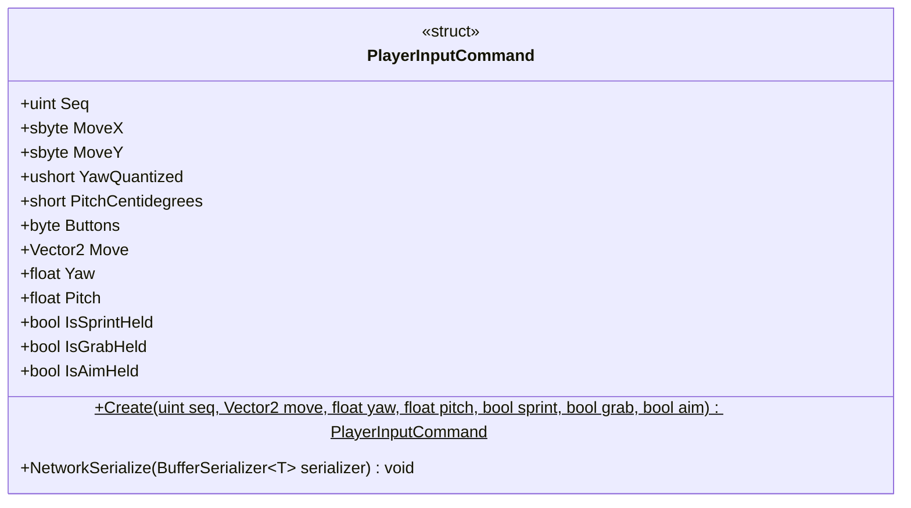

# PlayerInputCommand

> One physics step of a player's input, quantized for the wire (11 bytes): sequence, move (sbyte per axis), camera view (yaw as ushort over 360 deg, pitch in centidegrees) and the held buttons as bits.

**Módulo:** [[Modulo Networking|Networking]] · **Namespace:** `AlienFarms.Networking.Player` · **Archivo:** `Assets/Scripts/Networking/Player/PlayerInputCommand.cs`

## Hereda / implementa
`INetworkSerializable`

## Diagrama

## Usado por
[[InputCommandBatch]], [[InputCommandBuffer]], [[Mode]], [[NetworkCommandSource]], [[NetworkPlayerInput]]
