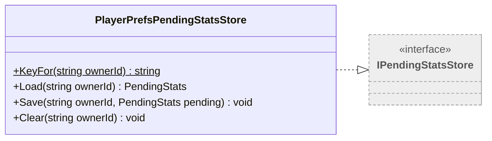

# PlayerPrefsPendingStatsStore

> `IPendingStatsStore` on PlayerPrefs, key stats.pending.{ugsId} (one per account, so MPPM clones sharing PlayerPrefs never collide). Every write and delete is flushed with `PlayerPrefs.Save`, so a round recorded right before closing the game survives. Invalid or newer entries are logged and deleted.

**Módulo:** [[Modulo Networking|Networking]] · **Namespace:** `AlienFarms.Networking.Persistence` · **Archivo:** `Assets/Scripts/Networking/Persistence/PlayerPrefsPendingStatsStore.cs`

## Hereda / implementa
[[IPendingStatsStore]]

## Diagrama

## Usa
[[IPendingStatsStore]], [[PendingStats]], [[PendingStatsCodec]], [[StatsReadResult]]

## Usado por
[[NetworkRuntimeAnchor]]
