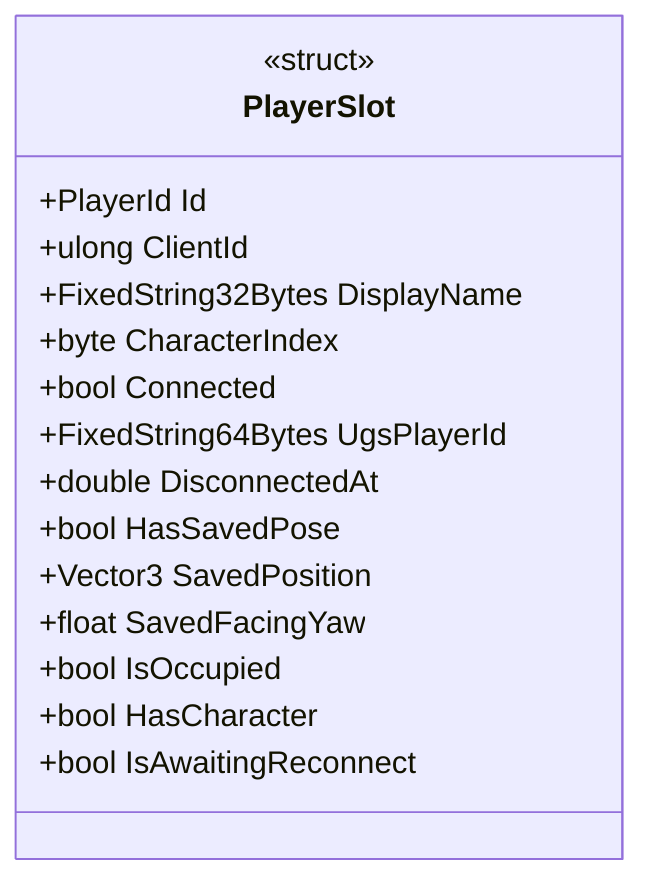

# PlayerSlot

> Server-side record of one player seat (plan: PlayerId, UgsPlayerId, ClientId, Name, Character, Connected, DisconnectedAt, SavedPose). A seat whose client dropped keeps `Connected` false and `DisconnectedAt` while it waits for the same `UgsPlayerId` to reconnect (`ServerSlotDirectory.MarkDisconnected`, used from 2.7).

**Módulo:** [[Modulo Networking|Networking]] · **Namespace:** `AlienFarms.Networking.Session` · **Archivo:** `Assets/Scripts/Networking/Session/PlayerSlot.cs`

## Diagrama

## Usa
[[PlayerId]]

## Usado por
[[ApprovalRules]], [[ConnectionApprovalHandler]], [[LobbyRules]], [[LobbySlotEntry]], [[NetworkLobbyState]], [[NetworkPlayer]], [[NetworkPlayerRoster]], [[ReconnectGraceCoordinator]], [[ReconnectGraceRules]], [[SeatGraceRules]], [[ServerSlotDirectory]]
