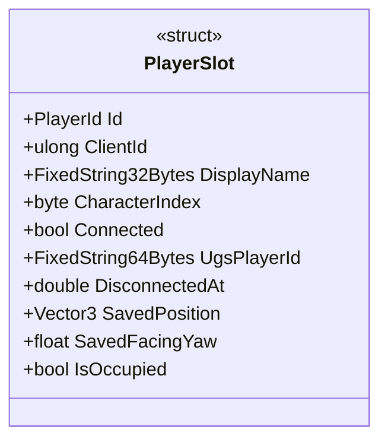

# PlayerSlot

> Server-side record of one player seat. Reconnection fields (`UgsPlayerId`, `DisconnectedAt`, `SavedPosition`, `SavedFacingYaw`) are reserved for week 2 and not used yet.

**Módulo:** [[Modulo Networking|Networking]] · **Namespace:** `AlienFarms.Networking.Session` · **Archivo:** `Assets/Scripts/Networking/Session/PlayerSlot.cs`

## Diagrama

## Usa
[[PlayerId]]

## Usado por
[[ConnectionApprovalHandler]], [[NetworkPlayerRoster]], [[ServerSlotDirectory]]
