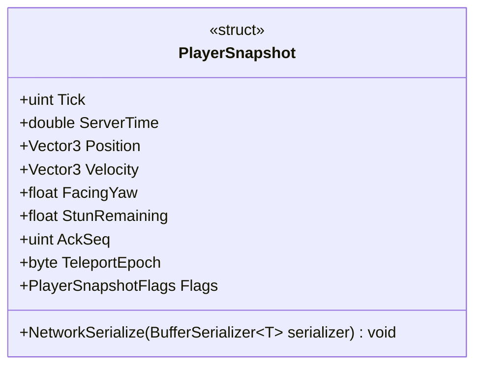

# PlayerSnapshot

> Authoritative state of one player after a server physics step, sent unreliably every step. `ServerTime` is on the NGO server clock, so clients render it at ServerTime - InterpolationDelay.

**Módulo:** [[Modulo Networking|Networking]] · **Namespace:** `AlienFarms.Networking.Player` · **Archivo:** `Assets/Scripts/Networking/Player/PlayerSnapshot.cs`

## Hereda / implementa
`INetworkSerializable`

## Diagrama

## Usa
[[PlayerSnapshotFlags]]

## Usado por
[[NetworkPlayerMotion]], [[SnapshotBuffer]], [[SnapshotInterpolator]]
