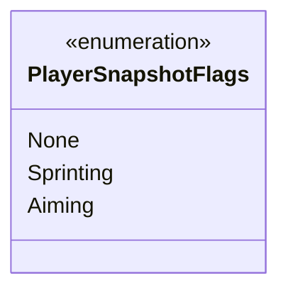

# PlayerSnapshotFlags

> Bit flags of a `PlayerSnapshot` (teleports travel as `PlayerSnapshot.TeleportEpoch`).

**Módulo:** [[Modulo Networking|Networking]] · **Namespace:** `AlienFarms.Networking.Player` · **Archivo:** `Assets/Scripts/Networking/Player/PlayerSnapshotFlags.cs`

## Hereda / implementa
`byte`

## Diagrama

## Valores
`None`, `Sprinting`, `Aiming`

## Usado por
[[InterpolatedPose]], [[NetworkPlayerMotion]], [[PlayerSnapshot]]
