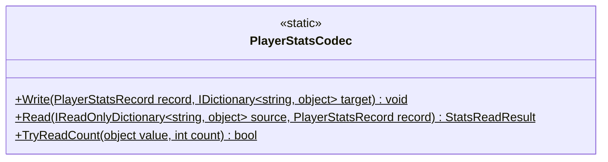

# PlayerStatsCodec

> Schema of the cloud stats record (key `Key`, a JSON object the Cloud Save SDK serializes): { "v": 1, "matches", "wins", "draws", "losses", "animals", "tackles", "batch" }. Pure: no SDK types. Reading accepts what the SDK's JSON deserialization yields for numbers (long, int, an integral double) and numeric strings; values are sanitized (see `PlayerStatsRules.Sanitize`) and clipped to `int.MaxValue`.

**Módulo:** [[Modulo Networking|Networking]] · **Namespace:** `AlienFarms.Networking.Persistence` · **Archivo:** `Assets/Scripts/Networking/Persistence/PlayerStatsCodec.cs`

## Diagrama

## Usa
[[PlayerStatsRecord]], [[PlayerStatsRules]], [[PlayerStatsSummary]], [[StatsReadResult]]

## Usado por
[[CloudSavePlayerStatsStore]], [[PlayerStatsLedger]], [[PlayerStatsRecord]]
