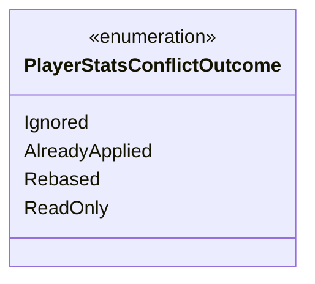

# PlayerStatsConflictOutcome

> What `PlayerStatsLedger.ResolveConflict` concluded from the reloaded record.

**Módulo:** [[Modulo Networking|Networking]] · **Namespace:** `AlienFarms.Networking.Persistence` · **Archivo:** `Assets/Scripts/Networking/Persistence/PlayerStatsConflictOutcome.cs`

## Diagrama

## Valores
`Ignored`, `AlreadyApplied`, `Rebased`, `ReadOnly`

## Usado por
[[PlayerStatsLedger]], [[PlayerStatsSync]]
