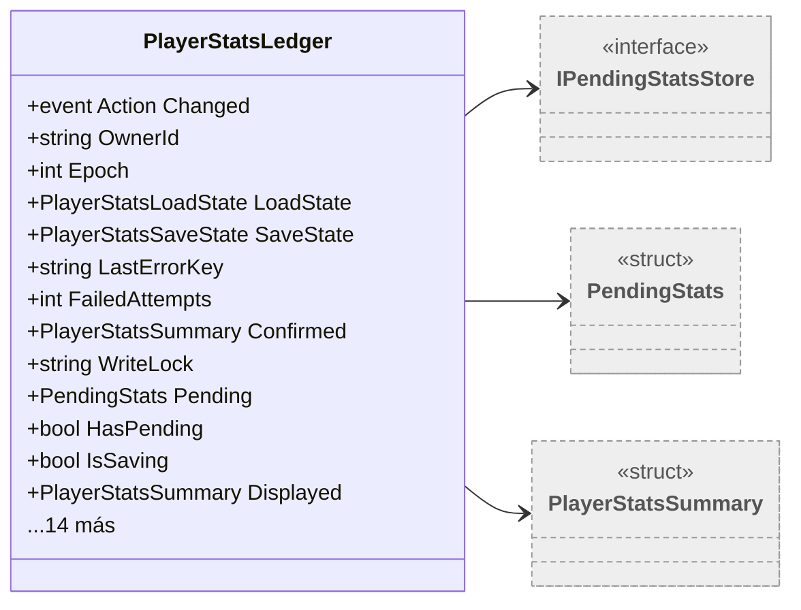

# PlayerStatsLedger

> Synchronization model of the local player's cloud stats (plain C#, no I/O, no collections). Holds the owner, the confirmed record and its write lock, the aggregated pending delta (persisted through `IPendingStatsStore`) and the batch in flight. The cloud save service drives it: load, enqueue rounds, save totals, resolve conflicts. Totals are absolute (confirmed + pending), so retrying the same batch gives the same record. Never saves before a successful load (summing the pending onto zero would overwrite the cloud). The pending stats have two segments (`PendingStats`): the head is what a write carries and is frozen once sent (a retry resends exactly it, so one batch id never stands for two contents); rounds enqueued meanwhile wait in the tail. A loaded or reloaded record that carries the head's batch means the head landed (lost response, or the game closed first): the head is dropped and the tail moves up, nothing counted twice or lost. Any other batch means it did not land: the head is unsent again and takes the tail. A newer or corrupt cloud record makes it `PlayerStatsLoadState.ReadOnly`: shown, never written.

**Módulo:** [[Modulo Networking|Networking]] · **Namespace:** `AlienFarms.Networking.Persistence` · **Archivo:** `Assets/Scripts/Networking/Persistence/PlayerStatsLedger.cs`

## Diagrama

## Usa
[[IPendingStatsStore]], [[PendingStats]], [[PlayerProgressErrorKeys]], [[PlayerStatsCodec]], [[PlayerStatsConflictOutcome]], [[PlayerStatsLoadState]], [[PlayerStatsRecord]], [[PlayerStatsRules]], [[PlayerStatsSaveState]], [[PlayerStatsSummary]], [[StatsReadResult]]

## Usado por
[[NetworkRuntimeAnchor]], [[OnlineMatchStatsRecorder]], [[PlayerStatsSync]]
