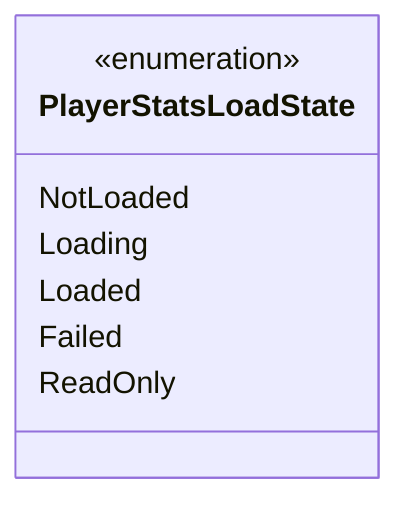

# PlayerStatsLoadState

> Load state of the `PlayerStatsLedger`.

**Módulo:** [[Modulo Networking|Networking]] · **Namespace:** `AlienFarms.Networking.Persistence` · **Archivo:** `Assets/Scripts/Networking/Persistence/PlayerStatsLoadState.cs`

## Diagrama

## Valores
`NotLoaded`, `Loading`, `Loaded`, `Failed`, `ReadOnly`

## Usado por
[[PlayerStatsLedger]], [[PlayerStatsSync]]
