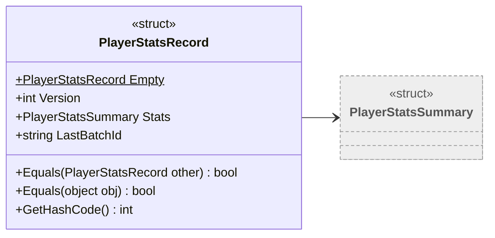

# PlayerStatsRecord

> The persisted stats of one player (cloud key `PlayerStatsCodec.Key`): schema version, absolute totals and the id of the last batch applied (idempotence across lost responses and conflicts).

**Módulo:** [[Modulo Networking|Networking]] · **Namespace:** `AlienFarms.Networking.Persistence` · **Archivo:** `Assets/Scripts/Networking/Persistence/PlayerStatsRecord.cs`

## Hereda / implementa
`IEquatable`

## Diagrama

## Usa
[[PlayerStatsCodec]], [[PlayerStatsSummary]]

## Usado por
[[CloudSavePlayerStatsStore]], [[IPlayerStatsStore]], [[PlayerStatsCodec]], [[PlayerStatsLedger]], [[PlayerStatsSync]], [[SimulatedFailureStatsStore]], [[StatsStoreResult]]
